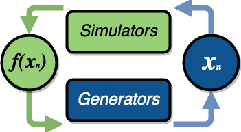

Understanding libEnsemble
=========================

Manager, Workers, Generators, and Simulators
~~~~~~~~~~~~~~~~~~~~~~~~~~~~~~~~~~~~~~~~~~~~
.. begin_overview_rst_tag

libEnsemble's **manager** allocates work from **generators** to **workers**,
which perform computations via **simulators**:

* :ref:`generator<funcguides-gen>`: Generates inputs for the *simulator*
* :ref:`simulator<funcguides-sim>`: Performs an evaluation using parameters from the *generator*

|

An :doc:`executor<executor/ex_index>` interface is available so generators and simulators
can launch and monitor external applications.

All simulations and generated values are recorded in a NumPy
structured array called the :ref:`history array<funcguides-history>`.

Example Use Cases
~~~~~~~~~~~~~~~~~
.. begin_usecases_rst_tag

.. dropdown:: **Click Here for Use-Cases**

  * A user wants to optimize a simulation calculation. The simulation may
    already be using parallel resources but not a large fraction of a
    computer. libEnsemble can coordinate concurrent evaluations of the
    simulator at multiple parameter values based on candidate parameter
    values produced by the generator (possibly after each simulator output).

  * A user has a generator that produces meshes for a
    simulator. Based on the simulator output, the generator can refine a mesh or
    produce a new mesh. libEnsemble ensures that generated meshes can be
    reused by multiple simulations without requiring data movement.

  * A user wants to evaluate a simulation with different sets of
    parameters, each drawn from a set of possible values. Some parameter values
    are known to cause the simulation to fail. libEnsemble can stop
    unresponsive evaluations and recover computational resources for future
    evaluations. The generator can update the sampling strategy after discovering
    regions where evaluations of the simulator fail.

  * A user has a simulation that requires calculating multiple
    expensive quantities, some of which depend on other quantities. The simulator
    can monitor intermediate quantities to stop related calculations early and
    preempt future calculations associated with poor parameter values.

  * A user has a simulation with multiple fidelities, where higher-fidelity
    evaluations require more computational resources. The generator and allocator
    decide which parameters should be evaluated and at what fidelity level. libEnsemble
    coordinates these evaluations without requiring the user to write parallel code.

  * A user wishes to identify multiple local optima for a simulation. In addition,
    sensitivity analysis is desired at each identified optimum. libEnsemble can
    use points from the APOSMM generator to identify optima. After a point is
    determined to be an optimum, a different generator can generate the
    parameter sets required for sensitivity analysis of the simulation.

  Combinations of these use cases are also supported.

Glossary
~~~~~~~~

.. dropdown:: **Click Here for Glossary**
  :open:

  * **Manager**: A single libEnsemble process that facilitates communication between
    other processes. The *Manager* configures and distributes work to
    workers and collects their output.

  * **Worker**: libEnsemble processes responsible for performing units of work,
    which may include executing tasks or submitting external jobs. Workers typically
    run simulators and return results to the manager.

  * **Executor**: A simple, portable interface for
    launching and managing tasks (applications). Multiple executors are
    available, including the base ``Executor`` and ``MPIExecutor``.

  * **Submit**: A *submitted* task is either executed
    immediately or queued for execution.

  * **Tasks**: Subprocesses or independent units of work. Tasks result from
    launching external programs for execution using the Executor.

  * **Resource Manager**: libEnsemble module that detects
    (or is provided with) available resources (e.g., nodes, cores, and GPUs) and
    divides them among workers. Resources can be dynamically reassigned, for example
    when the generator requests a number of processors or GPUs for each simulation.

  * **Slot**: A partition of a node assigned to a worker, numbered from zero on each
    node. See the :doc:`resource manager overview<resource_manager/overview>`.
